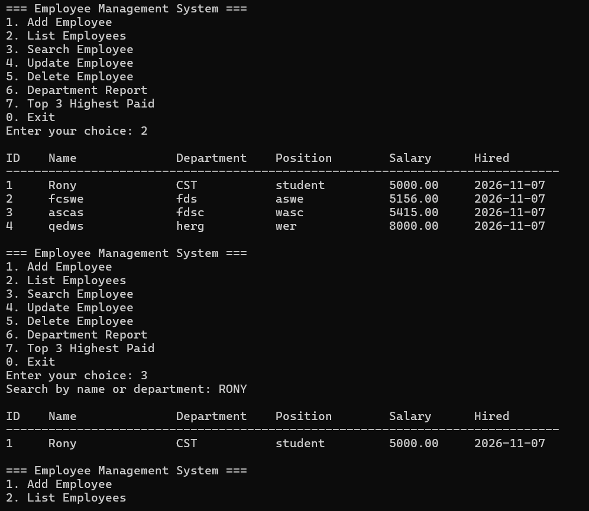

# Employee Management System

A console-based Employee Management System written in Python with an SQLite database. It manages employee records and generates department-wise salary reports.

## Features

- Add, list, search, update and delete employees
- Hire date recorded automatically
- Department report with employee count, average and total salary (SQL GROUP BY)
- Top 3 highest paid employees (ORDER BY with LIMIT)
- Input validation and parameterized SQL queries

## Technologies Used

- Python 3
- SQLite (built-in sqlite3 module)

## Database Design

employees (id, name, department, position, salary, hire_date)

## How to Run

1. Clone the repository
2. Make sure Python 3 is installed
3. Run: python main.py

The database file employees.db is created automatically on first run.

## Author

Rony - https://github.com/Rony60031
